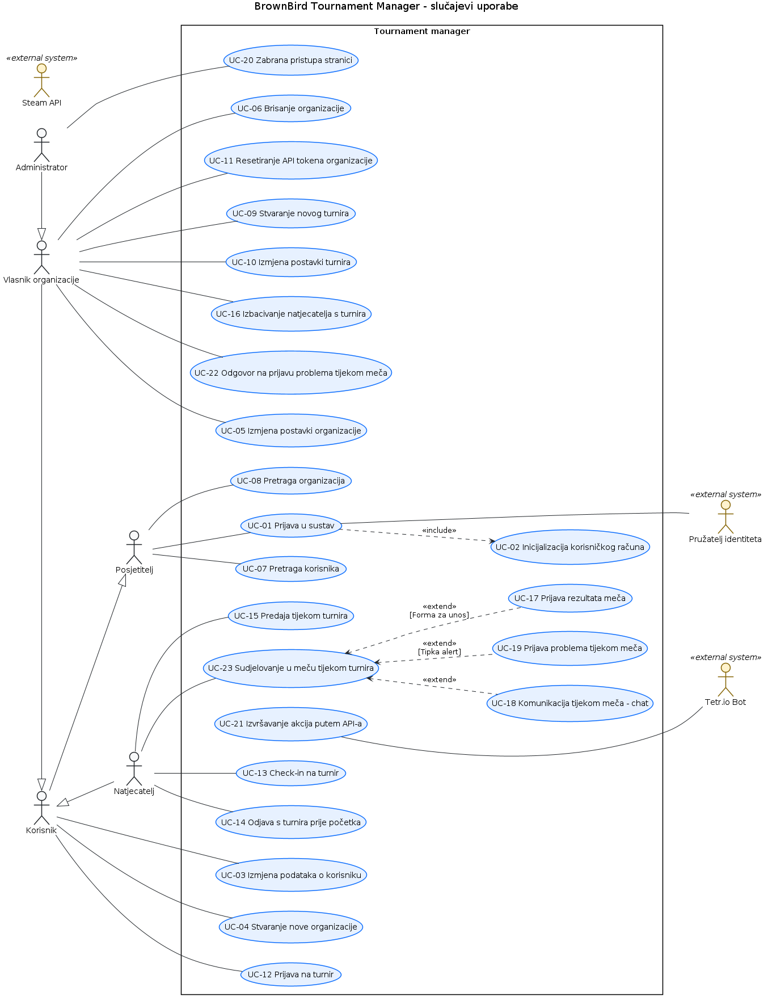

# Obrasci uporabe

## Dijagram obrazaca uporabe

## Specifikacije obrazaca uporabe

### UC-01: Prijava u sustav

| Polje | Opis |
|-------|------|
| Primarni akter | Posjetitelj (A-05) |
| Povezani zahtjevi | Nema |
| Preduvjeti | Nalazi se na stranici za prijavu, ima postojeći račun na stranici |
| Glavni tijek | 1. Posjetitelj odabire autentifikacijskog poslužitelja (npr. tetr.io, Steam)   2. Posjetitelj je preusmjeren na stranice vanjskog poslužitelja (oauth2 protokol)   3. Posjetitelj izvršava potrebne korake autentifikacije   4. Posjetitelj je preusmjeren natrag na stranice aplikacije   5. Korisnik je preusmjeren na svoj dashboard |
| Alternativni ili neuspješni tijekovi, ako postoje | **3a - Autentifikacijski poslužitelj nije dostupan:** korisnik dobiva poruku da pokuša kasnije |
| Rezultat | Korisnik je autentificiran i podaci o novom korisniku su spremljeni u sustav |

### UC-02: Inicijalizacija korisničkog računa

| Polje | Opis |
|-------|------|
| Primarni akter | Posjetitelj (A-05) |
| Povezani zahtjevi | Nema |
| Preduvjeti | Prva prijava korisnika na sustav |
| Glavni tijek | 1. Korisnik odabire svoje korisničko ime   2. Korisnik je preusmjeren na svoj dashboard |
| Alternativni ili neuspješni tijekovi, ako postoje |  **1a - Korisničko ime već postoji:** posjetitelju se javlja greška i traži se unos novog korisničkog imena |
| Rezultat | Korisničko ime je pohranjeno u sustav i račun je spreman za uporabu |

### UC-03: Izmjena podataka o korisniku

| Polje | Opis |
|-------|------|
| Primarni akter | Korisnik (A-01) |
| Povezani zahtjevi | F-02 |
| Preduvjeti | Korisnik je prijavljen |
| Glavni tijek | 1. Korisnik otvara postavke profila   2. Unosi promjene (nickname, opis, banner)   3. Aplikacija provjerava i sprema promjene |
| Alternativni ili neuspješni tijekovi, ako postoje | **3a - Nevaljani unos (npr. prazan nickname)** Aplikacija vraća prethodne postavke |
| Rezultat | Podatci o korisniku su izmjenjeni |

### UC-04: Stvaranje nove organizacije

| Polje | Opis |
|-------|------|
| Primarni akter | Korisnik (A-01) |
| Povezani zahtjevi | F-03 |
| Preduvjeti | Korisnik je prijavljen |
| Glavni tijek | 1. Korisnik pokreće stvaranje organizacije, unosi osnovne podatke   2. Aplikacija provjerava valjanost podataka   3. Aplikacija stvara organizaciju, postavlja korisnika kao vlasnika, generira stranice organizacije |
| Alternativni ili neuspješni tijekovi, ako postoje | **2a - Nevaljani unos (npr. već zauzeto ime)** Aplikacija ispisuje problem i ne stvara organizaciju |
| Rezultat | Organizacija postoji i javno je dostupna, vlasnik može stvarati turnire |

### UC-05: Izmjena postavki organizacije

| Polje | Opis |
|-------|------|
| Primarni akter | Vlasnik organizacije (A-03) |
| Povezani zahtjevi | F-03, F-25 |
| Preduvjeti | Vlasnik organizacije je prijavljen i zadužen za organizaciju koju želi izmijeniti |
| Glavni tijek | 1. Vlasnik otvara stranicu za izmjenu postavki organizacije   2. Mijenja postavke o organizaciji i/ili dodaje nove vlasnike organizacije   3. Aplikacija sprema promjene |
| Alternativni ili neuspješni tijekovi, ako postoje | **3a - Nevaljani unos** Aplikacija ispisuje problem i zadržava prethodne postavke organizacije |
| Rezultat | Promijenjeni su podatci organizacije te skup vlasnika |

### UC-06: Brisanje organizacije

| Polje | Opis |
|-------|------|
| Primarni akter | Vlasnik organizacije (A-03) |
| Povezani zahtjevi | F-03 |
| Preduvjeti | Vlasnik organizacije je prijavljen i zadužen za organizaciju koju želi izbrisati |
| Glavni tijek | 1. Vlasnik otvara stranicu za izmjenu postavki organizacije   2. Odabire opciju za brisanje organizacije   3. Potvrđuje da želi izbrisati organizaciju, brisanje je trajno |
| Alternativni ili neuspješni tijekovi, ako postoje | **3a - Brisanje nije potvrđeno** Organizacija ostaje nepromijenjena |
| Rezultat | Organizacija je izbrisana, javne stranice nisu dostupne |

### UC-07: Pretraga korisnika

| Polje | Opis |
|-------|------|
| Primarni akter | Posjetitelj (A-05) |
| Povezani zahtjevi | F-01, F-06 |
| Preduvjeti | Nema |
| Glavni tijek | 1. Posjetitelj unosi pojam za pretragu korisnika   2. Aplikacija vraća popis korisnika koji se podudaraju s unosom   3. Posjetitelj prelazi na profilnu stranicu korisnika |
| Alternativni ili neuspješni tijekovi, ako postoje | **2a - Nema podudaranja** Aplikacija ispisuje da ne postoji korisnik koji se podudara s unosom |
| Rezultat | Nema promjene stanja |

### UC-08: Pretraga organizacija

| Polje | Opis |
|-------|------|
| Primarni akter | Posjetitelj (A-05) |
| Povezani zahtjevi | F-06, F-08 |
| Preduvjeti | Nema |
| Glavni tijek | 1. Posjetitelj unosi pojam za pretragu organizacija   2. Aplikacija vraća popis organizacija koje se podudaraju s unosom   3. Posjetitelj prelazi na stranicu organizacije |
| Alternativni ili neuspješni tijekovi, ako postoje | **2a - Nema podudaranja** Aplikacija ispisuje da ne postoji organizacija koja se podudara s unosom |
| Rezultat | Nema promjene stanja |

### UC-09: Stvaranje novog turnira

| Polje | Opis |
|-------|------|
| Primarni akter | Vlasnik organizacije (A-03) |
| Povezani zahtjevi | F-07 |
| Preduvjeti | Vlasnik organizacije je prijavljen |
| Glavni tijek | 1. Vlasnik otvara stranicu za stvaranje novih turnira i unosi osnovne podatke turnira   2. Aplikacija provjerava valjanost podataka   3. Aplikacija stvara novi turnir, generira stranice turnira |
| Alternativni ili neuspješni tijekovi, ako postoje | **2a - Nevaljani unos** Aplikacija ispisuje pogrešku i ne stvara novi turnir |
| Rezultat | Stvoren je novi turnir unutar organizacije |

### UC-10: Izmjena postavki turnira

| Polje | Opis |
|-------|------|
| Primarni akter | Vlasnik organizacije (A-03) |
| Povezani zahtjevi | F-07, F-09, F-12, F-14, F-15, F-16, F-27 |
| Preduvjeti | Vlasnik organizacije je prijavljen |
| Glavni tijek | 1. Vlasnik otvara stranicu za izmjenu postavki turnira   2. Mijenja podatke o turniru kao što su ime, banner, opis, pravila, datum, podjelu u grupe, algoritam za faze...   3. Stranica provjerava valjanost unesenih podataka i sprema promjene |
| Alternativni ili neuspješni tijekovi, ako postoje | **2a - Nevaljani unos** Aplikacija ispisuje pogrešku i ne sprema nove postavke |
| Rezultat | Promijenjene su postavke turnira |

### UC-11: Resetiranje API tokena organizacije

| Polje | Opis |
|-------|------|
| Primarni akter | Vlasnik organizacije (A-03) |
| Povezani zahtjevi | F-11 |
| Preduvjeti | Vlasnik organizacije je prijavljen |
| Glavni tijek | 1. Vlasnik otvara API postavke organizacije.   2. Briše stari i stvara novi API token s opisom namjene.   3. Aplikacija mijenja stari token novim i jednokratno ga prikazuje |
| Alternativni ili neuspješni tijekovi, ako postoje | Nema |
| Rezultat | Organizacija sada može koristiti bota putem API tokena |

### UC-12: Prijava na turnir

| Polje | Opis |
|-------|------|
| Primarni akter | Korisnik (A-01) |
| Povezani zahtjevi | F-12 |
| Preduvjeti | Korisnik je prijavljen |
| Glavni tijek | 1. Natjecatelj otvara stranicu turnira   2. Odabire opciju za prijavu na turnir   3. Aplikacija traži od korisnika da se poveže vanjskom platformom koju natjecanje zahtjeva   4. Aplikacija prijavljuje korisnika na turnir |
| Alternativni ili neuspješni tijekovi, ako postoje | **2a - Natjecatelj je već prijavljen** Aplikacija ispisuje grešku i ne mijenja stanje   **3a - Korisnik se nije uspješno prijavio vanjskom platformom** Aplikacija ispisuje grešku i ne mijenja stanje   **4a - Prijava bi premašila ograničenje natjecatelja** Aplikacija ispisuje da postoji ograničenje na broj natjecatelja i ne mijenja stanje |
| Rezultat | Korisnik je prijavljen na turnir, postaje natjecatelj, A-02 |

### UC-13: Check in na turnir

| Polje | Opis |
|-------|------|
| Primarni akter | Natjecatelj (A-02) |
| Povezani zahtjevi | F-13 |
| Preduvjeti | Natjecatelj je prijavljen u sustav i na turnir, period za check in je otvoren |
| Glavni tijek | 1. Natjecatelj otvara stranicu turnira   2. Aplikacija prikazuje sučelje za check in   3. Natjecatelj potvrđuje check in   4. Aplikacija zapisuje prisutnost |
| Alternativni ili neuspješni tijekovi, ako postoje | **2a - Check in period nije otvoren** Aplikacija ispisuje grešku |
| Rezultat | Natjecatelj je označen kao prisutan |

### UC-14: Odjava s turnira prije početka

| Polje | Opis |
|-------|------|
| Primarni akter | Natjecatelj (A-02) |
| Povezani zahtjevi | F-16 |
| Preduvjeti | Natjecatelj je prijavljen u sustav i na turnir, turnir još nije počeo |
| Glavni tijek | 1. Natjecatelj otvara stranicu turnira   2. Odabire opciju za odjavu turnira   3. Aplikacija briše prijavu i uklanja natjecatelja |
| Alternativni ili neuspješni tijekovi, ako postoje | **2a - Turnir je već započeo** Aplikacija ispisuje da odjava više nije moguća |
| Rezultat | Natjecatelj više nije prijavljen na turnir |

### UC-15: Predaja tjekom turnira

| Polje | Opis |
|-------|------|
| Primarni akter | Natjecatelj (A-02) |
| Povezani zahtjevi | F-16 |
| Preduvjeti | Natjecatelj je prijavljen u sustav i na turnir, traje turnir |
| Glavni tijek | 1. Natjecatelj otvara stranicu turnira dok traje   2. Odabire opciju za predaju/izlazak iz turnira   3. Aplikacija bilježi izlazak i prilagođava iduće mečeve |
| Alternativni ili neuspješni tijekovi, ako postoje | **2a - Izlazak nije moguć** Aplikacija objašnjava da trenutno nije dopušten izlazak, stanje je nepromijenjeno |
| Rezultat | Natjecatelj je izašao iz turnira, mečevi se ažuriraju |

### UC-16: Izbacivanje natjecatelja s turnira

| Polje | Opis |
|-------|------|
| Primarni akter | Vlasnik organizacije (A-03) |
| Povezani zahtjevi | F-17, F-18 |
| Preduvjeti | Vlasnik organizacije je prijavljen u sustav, postoji natjecatelj kojeg treba izbaciti |
| Glavni tijek | 1. Vlasnik otvara popis natjecatelja na turniru   2. Pronalazi natjecatelja i odabire opciju za izbacivanje natjecatelja   3. Aplikacija uklanja natjecatelja i prilagođava iduće mečeve |
| Alternativni ili neuspješni tijekovi, ako postoje | Nema |
| Rezultat | Natjecatelj je uklonjen iz turnira, mečevi se ažuriraju |

### UC-17: Prijava rezultata meča

| Polje | Opis |
|-------|------|
| Primarni akter | Natjecatelj (A-02) |
| Povezani zahtjevi | F-21, F-27 |
| Preduvjeti | Natjecatelj je prijavljen u sustav, meč je završio |
| Glavni tijek | 1. Natjecatelj otvara stranicu meča   2. Natjecatelji ručno unose rezultat meča   3. Aplikacija provjerava slažu li se prijavljeni rezultati koje natjecatelji prijavljuju   4. Aplikacija pohranjuje rezultat |
| Alternativni ili neuspješni tijekovi, ako postoje | **2a - Ručni unos je isključen** Aplikacija odbija unos natjecatelja i objašnjava da rezultate mogu prijavljivati organizatori i/ili bot   **3a - Rezultati se ne slažu** Aplikacija ispisuje da se rezultati moraju poklapati, traži natjecatelje da obavijeste organizatora |
| Rezultat | Rezultat meča je zabilježen |

### UC-18: Komunikacija tijekom meča (chat)

| Polje | Opis |
|-------|------|
| Primarni akter | Natjecatelj (A-02) |
| Povezani zahtjevi | F-22 |
| Preduvjeti | Natjecatelj je prijavljen u sustav, meč je aktivan |
| Glavni tijek | 1. Natjecatelj otvara stranicu meča   2. Šalje tekstualnu poruku preko web chata meča   3. Aplikacija prenosi poruku |
| Alternativni ili neuspješni tijekovi, ako postoje | Nema |
| Rezultat | Poslana je poruka primatelju |

### UC-19: Prijava problema tijekom meča

| Polje | Opis |
|-------|------|
| Primarni akter | Natjecatelj (A-02) |
| Povezani zahtjevi | F-22 |
| Preduvjeti | Natjecatelj je prijavljen u sustav, postoji problem kojeg treba prijaviti |
| Glavni tijek | 1. Natjecatelj otvara stranicu za prijavu problema   2. Ispunjava obrazac gdje opisuje problem   3. Aplikacija stvara prijavu problema |
| Alternativni ili neuspješni tijekovi, ako postoje | Nema |
| Rezultat | Stvorena je prijava problema te je poslana organizatoru |

### UC-20: Onemogućavanje pristupa stranici natjecatelju

| Polje | Opis |
|-------|------|
| Primarni akter | Administrator (A-04) |
| Povezani zahtjevi | F-24, F-25 |
| Preduvjeti | Administrator je prijavljen u sustav, postoji natjecatelj kojem treba pristup biti onemogućen |
| Glavni tijek | 1. Administrator otvara administrativno sučelje za upravljanje korisnicima   2. Pronalazi korisnika kojemu pristup treba biti onemogućen   3. Odabire na koliko dugo će korisniku pristup biti onemogućen   4. Aplikacija onemogućuje pristup korisniku |
| Alternativni ili neuspješni tijekovi, ako postoje | Nema |
| Rezultat | Korisniku je privremeno ili trajno onemogućen pristup stranici |

### UC-21: Izvršavanje akcija putem API-ja

| Polje | Opis |
|-------|------|
| Primarni akter | Bot (A-06) |
| Povezani zahtjevi | F-26 |
| Preduvjeti | API ključ je valjan, osoba koja koristi API ima za to ovlasti |
| Glavni tijek | 1. Bot upisuje rezultat, šalje ili prima poruku u meču |
| Alternativni ili neuspješni tijekovi, ako postoje | **2a - Bot nema potrebne ovlasti** Ispisuje se greška |
| Rezultat | Izvršena je akcija putem API-ja |

### UC-22: Odgovor na prijavu problema tijekom meča

| Polje | Opis |
|-------|------|
| Primarni akter | Vlasnik organizacije (A-03) |
| Povezani zahtjevi | F-22 |
| Preduvjeti | Vlasnik organizacije je prijavljen u sustav, postoji prijavljeni problem |
| Glavni tijek | 1. Vlasnik organizacije otvara stranicu za prijavljene probleme   2. Riješava prijavljeni problem i šalje odgovor   3. Aplikacija obavještava korisnika da je problem riješen |
| Alternativni ili neuspješni tijekovi, ako postoje | Nema |
| Rezultat | Vlasnik organizacije je odgovorio na prijavljeni problem |
