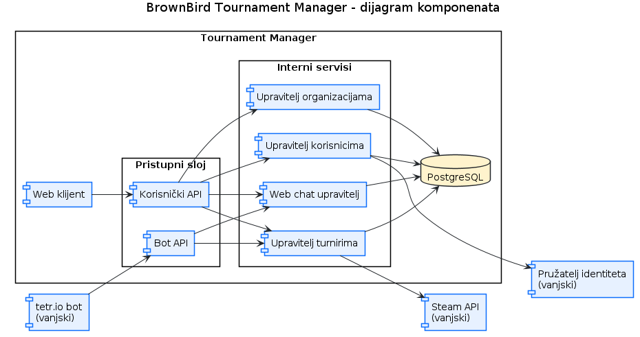
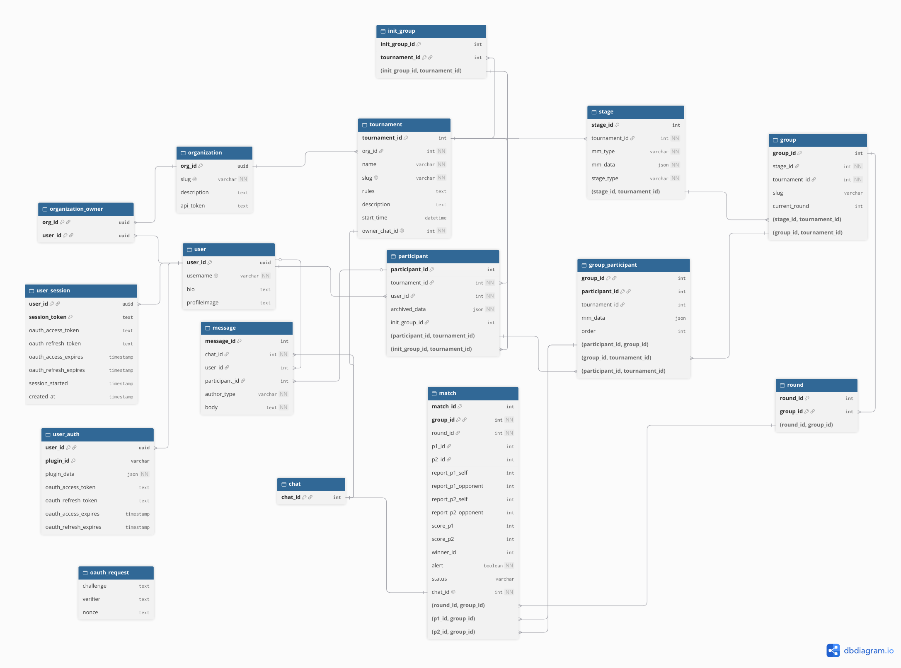

# Arhitektura i oblikovanje

[Primjeri](https://github.com/VladoSruk/Programsko-inzenjerstvo/blob/main/docs/4-Arhitektura-i-oblikovanje.md)

## Ključne arhitekturne odluke
| Odluka | Razmatrana alternativa | Projektno specifično obrazloženje i kompromis |
|--------|------------------------|-----------------------------------------------|

## Gradivni blokovi i UML dijagram komponenata

| Komponente | Odgovornost | Razlog za ovu granicu |
|------------|-------------|-----------------------|
| Web klijent | Prikazuje korisničko sučelje aplikacije i omogučuje korisniku interakciju sa sustavom | Korisnička interakcija je odvojena od poslužiteljske logike |
| Korisnički API | Ostvaruje komunikaciju između web sučelja i internih servisa | Način komunikacije specifičan za SvelteKit |
| Bot API | Omogućuju vanjskim programima pristup stanju turnira, chatu i upisu rezultata putem API tokena | Pristup samo parcijalnom dijelu funkcionalnosti i drugačiji način autentifikacije |
| Upravitelj korisnicima | Učitava sve konfigurirane načine autentifikacije te upravlja korisničkim računima | Komponenta je dovoljno izolirana da predstavlja vlastitu cjelinu |
| Web chat upravitelj | Podrška za chat funkcionalnost u aplikaciji: pohrana poruka | Komponenta je dovoljno izolirana da predstavlja vlastitu cjelinu |
| Upravitelj turnira | Implementira sve potrebne algoritme za generiranje ždrijeba, kreira mečeve, grupe i pohranjuje strukturu turnira u bazu | Komponenta je dovoljno izolirana da predstavlja vlastitu cjelinu |
| Upravitelj organizacijama | Upravlja postavkama organizacija i ovlastima korisnika u njima | Komponenta je dovoljno izolirana da predstavlja vlastitu cjelinu |

## ER dijagram i model podataka

[Otvori na dbdiagram.io](https://dbdiagram.io/d/Tournament-Manager-6aed988d7ded3580faca7098)

## Reprezentativni UML dijagram razreda

U procesu izrade...
